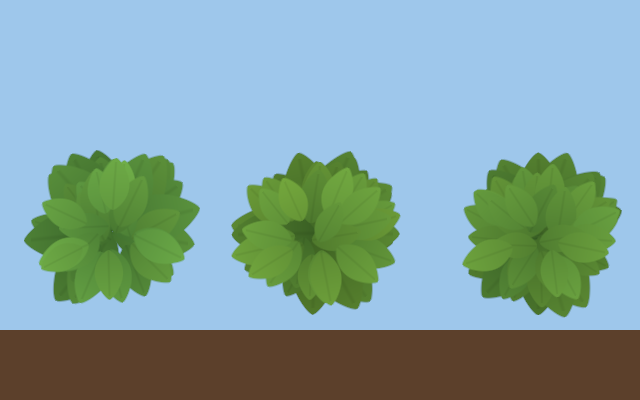

# Bushes

The **Bush Strip** component (**Add Component > Foliage 2D > Bush Strip**) places a row of bushes
along a strip; each bush is a cluster of leaf cards that sways and bends as one plant. The **Bush**
shader draws them. Settings shared by every family are on their own pages: [Wind](wind.md),
[Interaction](interaction.md), [Styles](styles.md) and [Pixel Art](pixel-art.md).

## Bush Strip

The object's position is the middle of the ground line; bushes grow upwards from it. Drag the edge
handles in the Scene view to resize the strip. Bush strips have no Density: Spacing decides how many
bushes fit.

| Setting | What it does |
|---|---|
| Size | Width and height of the strip in local units. A wider strip holds more bushes. |
| Seed | Random seed. Same seed, same bushes. **Randomize** in the inspector picks a new one. |
| Sorting Layer | Sorting layer of the strip's renderer. |
| Sorting Order | Order in layer ([Sorting and Depth](sorting-and-depth.md)). |
| Spacing | Distance between bushes in local units. The strip holds as many as fit (at least one). Below the bush width they overlap into a hedge. |
| Bush Size | Width and height of each bush as a fraction of the strip height, before the shape stretches it. |
| Leaves Per Bush | 4–200 leaves per bush. More leaves look fuller and cost a little more. |
| Shape | **Round**: a ball. **Tall**: narrow and upright. **Creeping**: low and wide, hugging the ground. |

Tips:

- A hedge is Tall bushes with a Spacing smaller than their width (see the `Bush_Hedge` prefab).
- Ground cover is Creeping bushes with tight spacing (see `Bush_GroundCover`).
- Leaves Per Bush is the main cost of a bush; 40–90 is plenty for most games.

## Bush material

### Color

| Setting | What it does |
|---|---|
| Base Color | Colour of the leaves at the bottom of the bush. |
| Top Color | Colour of the leaves at the top. Leaves blend from Base Color to Top Color. |
| Color Variation | How much each leaf's colour differs from its neighbours. |
| Inner Shade | Darkens the leaves deep inside the bush, so it reads as a round volume. |

### Shape

| Setting | What it does |
|---|---|
| Leaf Roundness | 0 gives pointed leaves; 1 gives round ones. |
| Leaf Size | Size of each leaf within its card. Lower values leave gaps between leaves. |

The rest of the material (Wind, Interaction, Brush, Pixel Art, Bands, Outline and Ignore 2D Lights)
works the same on every family: see the pages linked at the top.
