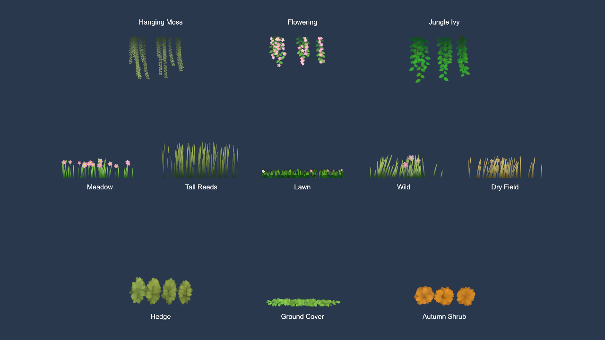

# Getting Started

This page assumes a URP project that uses the **2D Renderer** (for example, a project made from the
*Universal 2D* template). If yours doesn't, see [Pipeline Setup](pipeline-setup.md) first.

## 1. Add grass

1. Choose **GameObject > 2D Object > Foliage > Grass > Default** in the main menu (or **2D Object >
   Foliage > Grass > Default** when you right-click in the Hierarchy).
2. A *Grass* object appears at the centre of the Scene view. It has a **Grass Strip** component and
   the **Grass_Default** material.
3. Drag the handles on the strip's edges to resize it. The object's position is the middle of the
   ground line; grass grows upwards from it. A wider strip grows more plants instead of stretching
   them.
4. Press **Randomize** in the inspector for a different arrangement of the same plants.

Bushes and vines come the same way: **GameObject > 2D Object > Foliage > Bush > Default** and
**GameObject > 2D Object > Foliage > Vine > Default**. A vine strip hangs down from its position, so
place it at the edge of a ledge or ceiling.

## 2. Pick a style or a plant type

Each family's menu also offers a ready-made strip per style and per plant type. Each one is a
prefab with its own layout and material; the menu places an unpacked copy, so you can change
anything on it. You can also drag the prefabs from `Prefabs/<Family>` into the scene.

| Menu (GameObject > 2D Object > Foliage > …) | Prefab | Material |
|---|---|---|
| **GameObject > 2D Object > Foliage > Grass > Cartoon** | `Grass_Cartoon` | Grass_Cartoon |
| **GameObject > 2D Object > Foliage > Grass > Pixel Art** | `Grass_PixelArt` | Grass_PixelArt |
| **GameObject > 2D Object > Foliage > Grass > Painted** | `Grass_Painted` | Grass_Painted |
| **GameObject > 2D Object > Foliage > Grass > Realistic** | `Grass_Realistic` | Grass_Realistic |
| **GameObject > 2D Object > Foliage > Grass > Flat** | `Grass_Flat` | Grass_Flat |
| **GameObject > 2D Object > Foliage > Grass > Meadow** | `Grass_Meadow` | Grass_Spring, many flowers |
| **GameObject > 2D Object > Foliage > Grass > Tall Reeds** | `Grass_TallReeds` | Grass_Realistic, tall, mostly reeds |
| **GameObject > 2D Object > Foliage > Grass > Lawn** | `Grass_Lawn` | Grass_Cartoon, short and dense |
| **GameObject > 2D Object > Foliage > Grass > Wild** | `Grass_Wild` | Grass_Painted, clumps and gaps |
| **GameObject > 2D Object > Foliage > Grass > Dry Field** | `Grass_DryField` | Grass_Dry |
| **GameObject > 2D Object > Foliage > Bush > Cartoon** | `Bush_Cartoon` | Bush_Cartoon |
| **GameObject > 2D Object > Foliage > Bush > Pixel Art** | `Bush_PixelArt` | Bush_PixelArt |
| **GameObject > 2D Object > Foliage > Bush > Painted** | `Bush_Painted` | Bush_Painted |
| **GameObject > 2D Object > Foliage > Bush > Realistic** | `Bush_Realistic` | Bush_Realistic |
| **GameObject > 2D Object > Foliage > Bush > Flat** | `Bush_Flat` | Bush_Flat |
| **GameObject > 2D Object > Foliage > Bush > Hedge** | `Bush_Hedge` | Bush_Realistic, tall and close together |
| **GameObject > 2D Object > Foliage > Bush > Ground Cover** | `Bush_GroundCover` | Bush_Spring, low and creeping |
| **GameObject > 2D Object > Foliage > Bush > Autumn Shrub** | `Bush_AutumnShrub` | Bush_Autumn |
| **GameObject > 2D Object > Foliage > Vine > Cartoon** | `Vine_Cartoon` | Vine_Cartoon |
| **GameObject > 2D Object > Foliage > Vine > Pixel Art** | `Vine_PixelArt` | Vine_PixelArt |
| **GameObject > 2D Object > Foliage > Vine > Painted** | `Vine_Painted` | Vine_Painted |
| **GameObject > 2D Object > Foliage > Vine > Realistic** | `Vine_Realistic` | Vine_Realistic |
| **GameObject > 2D Object > Foliage > Vine > Flat** | `Vine_Flat` | Vine_Flat |
| **GameObject > 2D Object > Foliage > Vine > Hanging Moss** | `Vine_HangingMoss` | Vine_Moss, many small leaves |
| **GameObject > 2D Object > Foliage > Vine > Flowering** | `Vine_Flowering` | Vine_Blossom, with flowers |
| **GameObject > 2D Object > Foliage > Vine > Jungle Ivy** | `Vine_JungleIvy` | Vine_Jungle, long with big leaves |

To restyle any strip, select it, open its material in the Inspector and choose a **Style Preset**.
The shipped presets are shared: when you pick a style for an object that still uses one, Unity asks
whether to **Create a Copy** (your own material, next to your scene) or **Change the Preset** itself.
See [Presets](presets.md) and [Styles](styles.md).

## 3. Walk through it

1. Put a **Foliage Pusher 2D** on your player (**Add Component > Foliage 2D > Foliage Pusher 2D**).
   Plants within its Radius bend away and spring back once it has passed.
2. For grass the player walks *inside*, use **GameObject > 2D Object > Foliage > Grass (Front + Back)**:
   a back strip drawn behind the player and a shorter front strip drawn in front of it. Set the
   player's Sorting Order between the two (the menu uses -1 and 1, so 0 works). See
   [Sorting and Depth](sorting-and-depth.md).
3. Press Play.

## 4. Add wind

The plants already sway in a gentle built-in breeze. To control it, add an empty object with a
**Foliage Wind** component (**Add Component > Foliage 2D > Foliage Wind**) and set its Strength and
gusts. See [Wind](wind.md).

## Next steps

- Shape each family: [Grass](grass.md), [Bushes](bushes.md), [Vines](vines.md).
- Match your art: [Styles](styles.md) and [Pixel Art](pixel-art.md).
- Try the demo scenes in `Demo/Scenes`: [Demo Scenes](demo-scenes.md).
