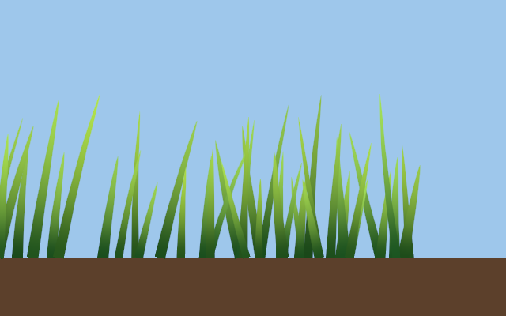
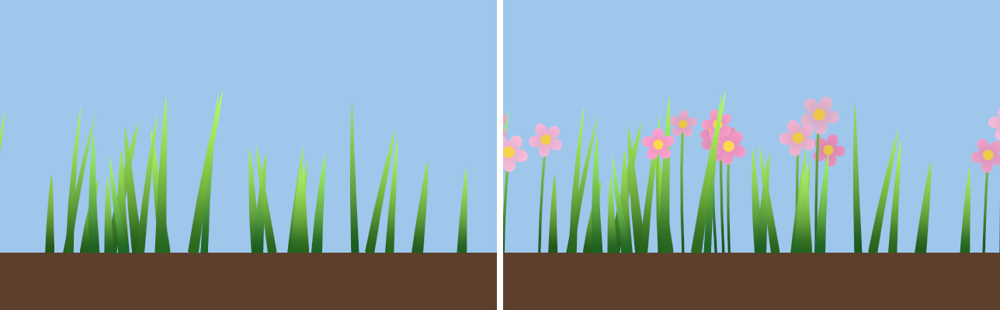

# Grass

The **Grass Strip** component (**Add Component > Foliage 2D > Grass Strip**) fills a rectangle with
grass blades, and optionally flowers and reeds, all in one mesh. The **Grass** shader draws them.
Settings shared by every family are on their own pages: [Wind](wind.md),
[Interaction](interaction.md), [Styles](styles.md) and [Pixel Art](pixel-art.md).

## Grass Strip

The object's position is the middle of the ground line; grass grows upwards from it. Drag the edge
handles in the Scene view to resize the strip.

| Setting | What it does |
|---|---|
| Size | Width and height of the strip in local units. Plants are generated, never stretched: a wider strip grows more of them. |
| Seed | Random seed. Same seed, same plants. **Randomize** in the inspector picks a new one. |
| Density | Plants per unit of width. |
| Sorting Layer | Sorting layer of the strip's renderer. |
| Sorting Order | Order in layer. Use one strip behind the player and one in front ([Sorting and Depth](sorting-and-depth.md)). |
| Height Range | Blade height range as a fraction of the strip height (min, max). |
| Blade Width | Average blade width in local units. |
| Clumping | 0 spreads blades evenly; 1 gathers them in tight clumps. |
| Lean | Base lean of all blades in degrees (positive leans right). |
| Gap Chance | Chance that a blade is skipped, leaving small natural gaps. |
| Segments | Segments per blade, 1–6. More segments bend more smoothly and cost a few more vertices. |
| Flower Ratio | Share of plants that are flowers: a thin stem with a flower head. The material's **Flowers** switch shows them. |
| Reed Ratio | Share of plants that are reeds: taller, straighter and stiffer than blades. |

Tips:

- Keep the object unrotated and its scale at 1; use Size instead. A scale of -1 on X mirrors the
  strip, which is fine (see [Troubleshooting](troubleshooting.md)).
- For grass seen from far away, lower Segments to 2 and raise Blade Width a little.
- For a pixel-art grid, keep Blade Width at two art pixels or more (2 ÷ Art Pixels Per Unit), as the
  `Grass_PixelArt` prefab does.

## Grass material

### Color

| Setting | What it does |
|---|---|
| Base Color | Colour at the root of each blade. Its alpha fades the whole strip. |
| Tip Color | Colour at the tip. Blades blend from Base Color to Tip Color. |
| Color Variation | How much each plant's colour differs from its neighbours. |
| Root Shade | Darkens the bottom of each blade, as if shaded by the others. |

### Shape

| Setting | What it does |
|---|---|
| Blade Roundness | 0 gives pointed blades; 1 gives round, leaf-like tips. |

### Flowers

Switch **Flowers** on to draw the flower plants (their share is the strip's Flower Ratio). Off,
those plants are not drawn.

| Setting | What it does |
|---|---|
| Flower Color A | Petal colour. Each flower picks a colour between Flower Color A and Flower Color B. Its alpha fades the flowers. |
| Flower Color B | Second petal colour. Set it equal to Flower Color A for flowers of a single colour. |
| Flower Center | Colour of the flower centres. |
| Petals | Number of petals, 3–8. |
| Flower Size | Size of the flower head relative to its card. |

The rest of the material (Wind, Interaction, Brush, Pixel Art, Bands, Outline and Ignore 2D Lights)
works the same on every family: see the pages linked at the top.
