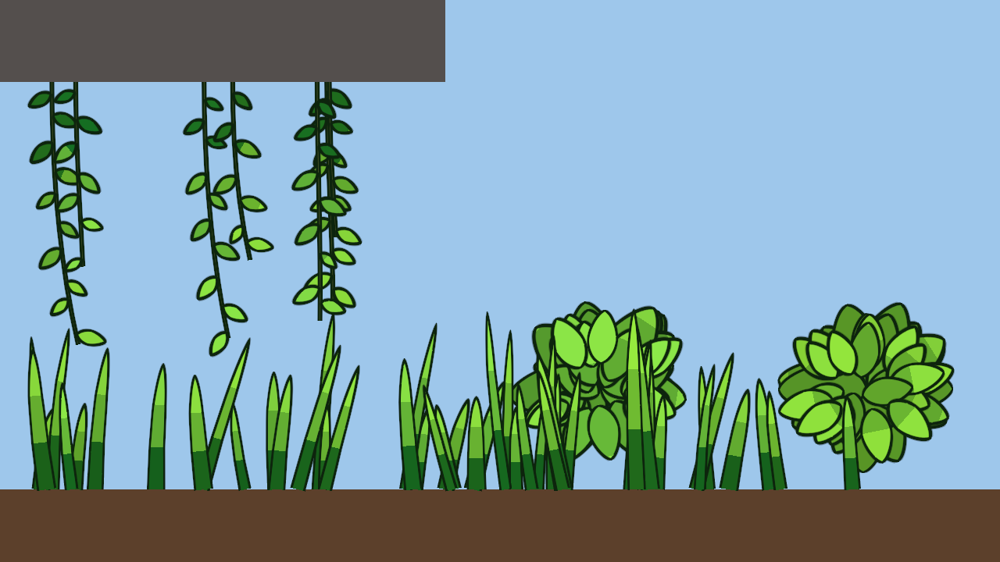

# Foliage Shaders 2D

Procedural 2D side-view foliage for Unity: grass, flowers, reeds, bushes and hanging vines that sway
in the wind, bend away from your player and are lit by URP 2D lights like your sprites. Cartoon,
Pixel Art, Painted, Realistic and Flat looks all come from the same three shaders.

You draw a strip in the Scene view, pick a style, and the plants are generated inside it. Nothing is
stretched: make the strip wider and more plants grow.

## What's in the pack

- **Three shaders**: Grass (blades, flowers and reeds), Bush (leaf clusters) and Vine (hanging stems
  with leaves and flowers). Every shader has switchable Pixel Art, Bands, Outline and Ignore 2D
  Lights effects and a painted Brush; Grass and Vine also switch Flowers.
- **Strip components** that build the plants as one mesh: Grass Strip, Bush Strip and Vine Strip,
  with Scene view handles to size them.
- **Wind** for the whole scene with travelling gusts, plus **wind zones** for local gusts or shelter.
- **Interaction**: plants bend away from anything with a Foliage Pusher 2D and spring back with a
  little bounce; scripted impulses for landings and explosions.
- **44 materials**: a default and style presets per family (Cartoon, Pixel Art, Painted, Realistic,
  Flat) plus colour variants (spring, autumn, dry, snow, fantasy, jungle, moss, blossom).
- **26 prefabs**: one per family and style, and 11 plant types (meadow, tall reeds, lawn, wild grass,
  dry field, hedge, ground cover, autumn shrub, hanging moss, flowering vine, jungle ivy).
- **Two demo scenes** with a small character, day and night, and a live material panel that also
  works in player builds.

## Requirements

- Unity 6 (6000.0 or newer).
- Universal Render Pipeline with the **2D Renderer**.
- Unity 2022.3, the URP 3D renderer and the Built-in pipeline are planned for later updates.

## Contents

| Page | Read it to… |
|---|---|
| [Getting Started](getting-started.md) | put foliage in your scene in two minutes |
| [Grass](grass.md) | shape grass, flowers and reeds |
| [Bushes](bushes.md) | shape bushes and hedges |
| [Vines](vines.md) | hang vines from ledges and ceilings |
| [Wind](wind.md) | set the scene's wind, gusts and wind zones |
| [Interaction](interaction.md) | make plants bend away from the player |
| [Styles](styles.md) | match the foliage to your art style |
| [Pixel Art](pixel-art.md) | snap the plants to your sprites' pixel grid |
| [Presets](presets.md) | use, create and switch style presets |
| [Sorting and Depth](sorting-and-depth.md) | let the player walk inside the grass |
| [Scripting API](scripting-api.md) | drive strips, wind and impulses from code |
| [Performance](performance.md) | keep foliage cheap, especially on mobile |
| [Pipeline Setup](pipeline-setup.md) | set up URP and the 2D Renderer |
| [Demo Scenes](demo-scenes.md) | explore the demos and the live material panel |
| [Troubleshooting](troubleshooting.md) | fix common problems |

## Support

Questions or problems: use the contact on the Asset Store page. Please include your Unity version,
render pipeline and a screenshot.
