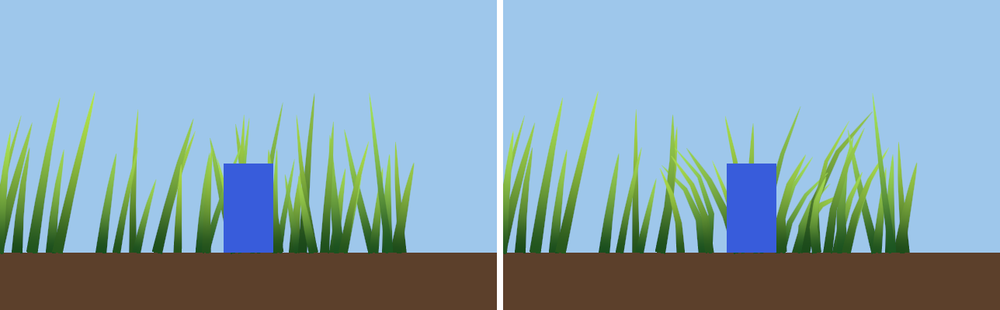

# Interaction

Plants bend away from the player, enemies and anything else you tag, then spring back with a little
bounce once it has passed. Like the wind, this happens in the shader from a few global values: no
physics and no colliders on the plants.

## Foliage Pusher 2D

Add it to anything that should push plants (**Add Component > Foliage 2D > Foliage Pusher 2D**),
typically the player. It needs no collider.

| Setting | What it does |
|---|---|
| Radius | How far around this object plants are pushed, in world units. About half the character's height reads well. |
| Strength | How hard plants are pushed. 1 is a person walking through grass; 2 is a charging animal. |
| Offset | Offset from the transform position, for example down to the character's feet. |



A moving pusher leaves a short trail behind it, so the plants it walked through spring back one
after another instead of all at once.

Limits: the shader receives 16 interaction slots per frame (`FoliageGlobals.MaxSlots`). Pushers come
first, nearest to the main camera first, then the newest impulses, then the newest trail points.
With many pushers on screen, trails get shorter; with 16 or more, impulses and trails don't get
through at all. Disable the pushers of characters far off screen.

## Impulses

A one-off radial burst, for a heavy landing or an explosion: plants within the radius bend away from
the centre and spring back.

```csharp
using SebastianEscobar.FoliageShaders2D;

FoliageGlobals.Impulse(transform.position, radius: 2f, strength: 1.5f);
```

The demo's Demo Impulse On Land component does this when the character lands hard
([Demo Scenes](demo-scenes.md)). Hanging plants only feel an impulse that happens among them: a
landing thump on the ground moves the grass and bushes, not the vines above it.

## Interaction

Each material decides how its plants react. The Interaction section is the same on every family.

| Setting | What it does |
|---|---|
| Push Response | How far plants bend away from pushers and impulses. 0 ignores them; 2 (the default) is a clear, playful bend. |
| Bounce | How springy plants are when a pusher leaves. 0 eases back to rest without overshooting; 1 swings past rest and wobbles a few times. Default 0.4 (vines 0.6). |
| Spring Back Speed | How quickly plants return to rest. Lower is slow, heavy and natural; higher is quick and snappy. Default 2 (vines 1.6). |

Tips:

- Heavy bushes: lower Push Response (1–1.5) and Bounce (0.2).
- Light, cartoon grass: Bounce 0.6–0.8 for a jelly wobble.
- Vines take a push as a force, like a rope: they start from rest, are carried the way the
  character moves while it runs into them, then swing back and settle little by little. A character
  that stops or walks away leaves them to swing on their own. Lower their Bounce for heavy, wet vines.
- Bushes are heavy: each leaf takes only part of a pusher's bend, so a bush parts and leans a little
  instead of lying down like grass.
