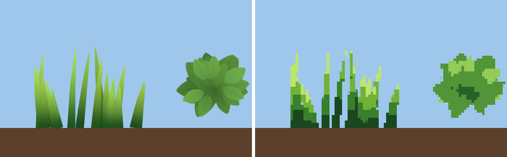

# Pixel Art

With **Pixel Art** on, plants are drawn on a grid of square art pixels with hard edges and a limited
palette, and they bend in whole pixels, so they sit next to your pixel-art sprites without blur.

*Shown at 32 art pixels per unit; the Pixel Art presets use 16.*

## Setting it up

1. Use a Pixel Art preset (`Grass_PixelArt`, `Bush_PixelArt`, `Vine_PixelArt`) or switch **Pixel
   Art** on in any foliage material.
2. Set **Art Pixels Per Unit** to your sprites' Pixels Per Unit (16 in the presets). It goes from 8 to
   64, the usual range for pixel art; sprites at Unity's default of 100 aren't pixel art.
3. **Recommended:** add URP's **Pixel Perfect Camera** to your camera and set its *Assets Pixels Per
   Unit* to the same value. Without it the art pixels still line up, but they can differ in size by
   one screen pixel at some resolutions and look uneven while the camera moves. The *PixelArt* demo
   scene uses it (16 PPU, reference resolution 320 × 180).
4. Prefer the Pixel Art prefabs (**GameObject > 2D Object > Foliage > Grass > Pixel Art** and the
   same for Bush and Vine): their layout has blades at least two art pixels wide and vine stems one
   art pixel wide. Thin default blades turn into scattered single pixels.

While a strip uses a pixel-art material, its width and height snap to whole art pixels. Your typed
size is kept: switch Pixel Art off and the strip returns to it.

## Pixel Art

| Setting | What it does |
|---|---|
| Art Pixels Per Unit | Size of the art pixels: how many fit in one world unit, 8–64. Match your sprites' Pixels Per Unit. |
| Palette Size | How many palette colours are used, 2–4, from Palette 1 upwards. |
| Palette 1 (Root) | Darkest colour, used at the roots. |
| Palette 2 | Second colour. |
| Palette 3 | Third colour. |
| Palette 4 (Tip) | Lightest colour, used at the tips. |

The palette replaces the colour gradient: each plant picks its colours from it, dark at the root and
light at the tip. 2D lights then brighten or darken the palette colours, the same way they light a
pixel-art sprite. Flowers keep their own colours, snapped to the grid.

Tips:

- Take the palette straight from your sprites' palette.
- Outline Width snaps to at least one art pixel; one pixel is usually right.
- Brush is ignored under Pixel Art.
- Avoid rotating or scaling strips (see [Troubleshooting](troubleshooting.md)); mirror with a scale
  of -1 on X if you need to.
