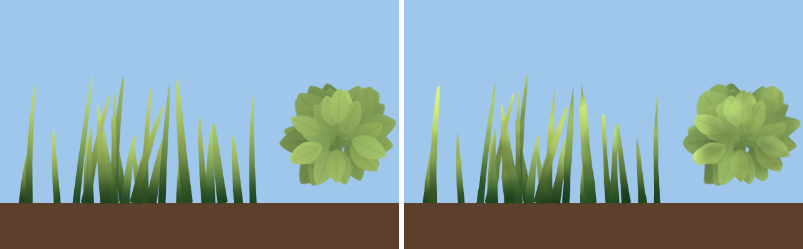
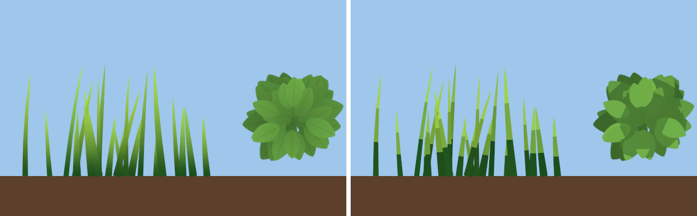
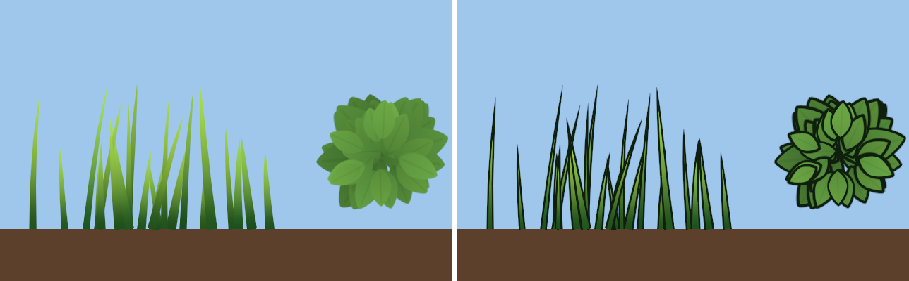
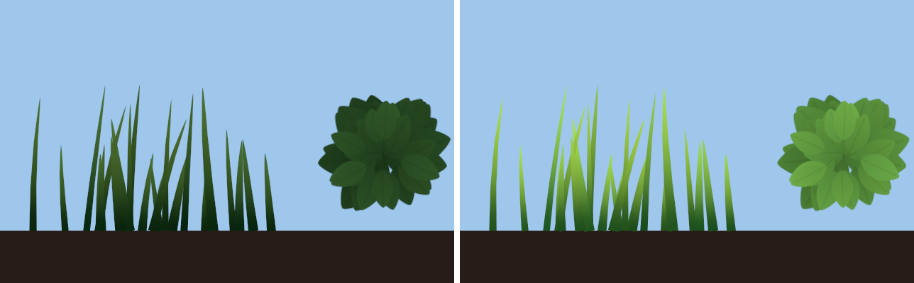
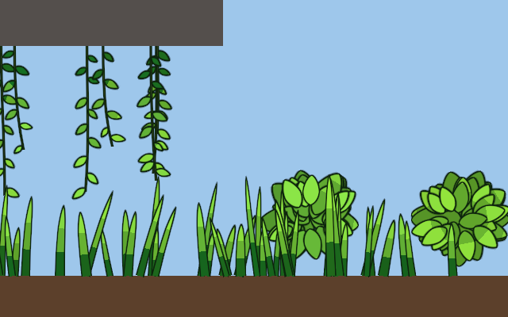
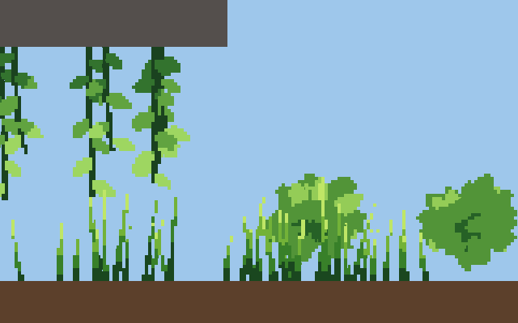
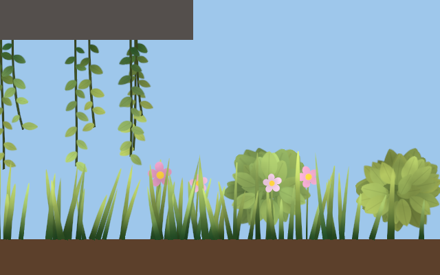
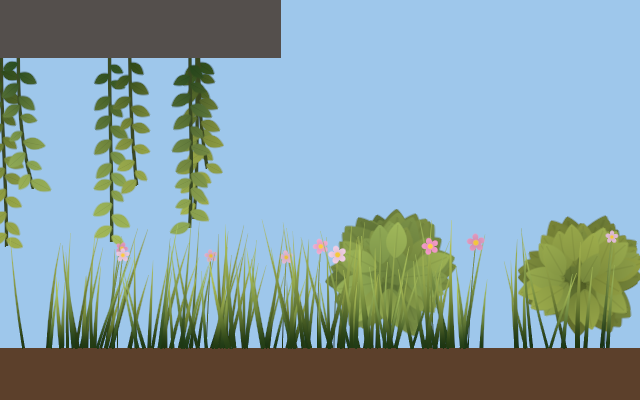
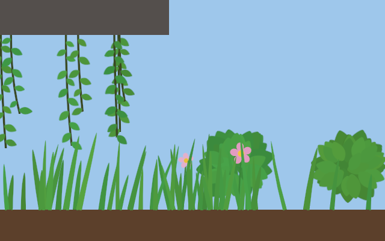

# Styles

Every look comes from the same shaders: a style is a combination of switches and values in the
material. Pick the closest one with **Style Preset** in the material inspector, then adjust it to
your art ([Presets](presets.md) explains how presets work). Edit your own copy rather than a shipped
material: see [Presets](presets.md#using-a-preset).

| Style | Switches on | Character |
|---|---|---|
| Cartoon | Bands (3), Outline | Round tips, bold flat steps, a dark line around every blade and leaf. |
| Pixel Art | Pixel Art | Square art pixels, hard edges, a 4-colour palette ([Pixel Art](pixel-art.md)). |
| Painted | Brush | Streaky brush strokes and rough edges, strong colour variation. |
| Realistic | none | Thin pointed blades, natural colours, more flutter. |
| Flat | Bands (2) | One flat colour per plant, clean vector-like shapes. |

Each family also has colour variants (Spring, Autumn, Fantasy and more) in two versions: on the
default look and on the Cartoon look. They change colours only. See the full list in
[Presets](presets.md#shipped-presets).

General advice:

- **Colours first.** Take Base Color and Tip Color (Top Color, Bottom Color on vines) from your
  palette. Blades blend between the two.
- **Match the plant size to your characters.** Grass up to the knee and bushes up to the hip read well.
- **One switch at a time.** Turn on a single effect, look, then move on.
- Bigger layout changes (thinner blades, more segments, fewer leaves) belong to the strip, not the
  material: the style prefabs in `Prefabs/<Family>` carry a layout that suits each style.

## Brush

The painted look: streaks the colours and roughens the edges like brush strokes. It is ignored while
Pixel Art is on.

| Setting | What it does |
|---|---|
| Brush Noise Texture | Noise used by the brush. The pack's FoliageNoise works; any tileable greyscale noise does. |
| Brush Strength | 0 is off (no texture is read, so it costs nothing); higher streaks the colours more. |
| Brush Scale | Size of the strokes: higher gives finer strokes. |

## Bands

Turns the root-to-tip gradient into a few flat steps, for cel-shaded cartoon art.

| Setting | What it does |
|---|---|
| Band Count | Number of flat colour steps from root to tip, 2–5. With 2 and equal Base and Tip colours you get the Flat style. |

## Outline

Draws a line along the inside edge of every blade, leaf and petal.

| Setting | What it does |
|---|---|
| Outline Color | Colour of the outline. Its alpha sets how strong it is. |
| Outline Width | Thickness in world units (at least one art pixel under Pixel Art). |

## Ignore 2D Lights

Under a dim blue night light: lit plants darken, plants that ignore 2D lights keep their colours.

Switch it on to show the colours exactly as set, ignoring URP 2D lights: for unlit games, UI, or a
background layer that should not darken at night. Off (the default), the plants are lit by your 2D
lights like your sprites.

## Style notes

### Cartoon

- Keep Color Variation low (around 0.25): flat steps look best with steady colours.
- Blade Roundness and Leaf Roundness near 0.8–0.9 give soft, toy-like shapes.
- Darken the Outline Color from your plant's darkest colour rather than using black.

### Pixel Art

*Shown at 32 art pixels per unit; the Pixel Art presets use 16.*

See [Pixel Art](pixel-art.md): match Art Pixels Per Unit to your sprites and use a Pixel Perfect
Camera.

### Painted

- Brush Strength 0.4–0.7 and Brush Scale around 2.
- Raise Color Variation (0.6–0.8) so neighbouring plants differ like separate strokes.

### Realistic

- Thin blades (Blade Width around 0.035) and a high Density; Segments 4 for smooth bends.
- Root Shade around 0.45 adds depth at the base of a field.

### Flat

- Pick one colour for Base Color and Tip Color and let Color Variation separate the plants.
- Root Shade 0 keeps each plant a single, clean shape.
