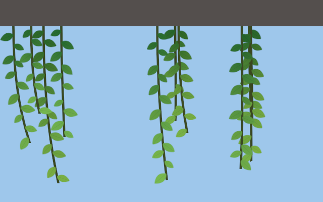

# Vines

The **Vine Strip** component (**Add Component > Foliage 2D > Vine Strip**) hangs vines down from a
line: thin stems with leaves on alternate sides, and optionally flowers. The whole vine swings like a
rope in the wind and when something pushes it. The **Vine** shader draws them. Settings shared by
every family are on their own pages: [Wind](wind.md), [Interaction](interaction.md),
[Styles](styles.md) and [Pixel Art](pixel-art.md).

## Vine Strip

The object's position is the middle of the **top** edge: vines hang down from it, so place it under
a ledge, a ceiling or a branch. In the Scene view, drag the bottom handle down to lengthen the vines.

| Setting | What it does |
|---|---|
| Size | Width of the hanging line and the longest vine length, in local units. |
| Seed | Random seed. Same seed, same vines. **Randomize** in the inspector picks a new one. |
| Density | Vines per unit of width. |
| Sorting Layer | Sorting layer of the strip's renderer. |
| Sorting Order | Order in layer ([Sorting and Depth](sorting-and-depth.md)). |
| Length Range | Vine length range as a fraction of the strip height (min, max). |
| Leaves Per Unit | Leaves per unit of vine length. |
| Flower Ratio | Share of leaf spots that carry a flower instead. The material's **Flowers** switch shows them; with it off, those spots stay empty. |
| Stem Width | Width of the stems in local units. |
| Leaf Scale | Size of the leaves (and flowers) relative to the default. |

Tips:

- Hanging moss: many small leaves (Leaves Per Unit above 20, Leaf Scale around 0.6) on thin stems.
- Jungle ivy: few big leaves (Leaf Scale 1.5 or more) on long vines.
- For pixel art, make Stem Width one art pixel (1 ÷ Art Pixels Per Unit) and raise Leaf Scale so each
  leaf covers a few pixels, as the `Vine_PixelArt` prefab does.

## Vine material

### Color

| Setting | What it does |
|---|---|
| Top Color | Colour of the leaves near the top of each vine. |
| Bottom Color | Colour near the tip. Leaves blend from Top Color to Bottom Color. |
| Stem Color | Colour of the stems. |
| Color Variation | How much each leaf's colour differs from its neighbours. |

### Shape

| Setting | What it does |
|---|---|
| Leaf Roundness | 0 gives pointed leaves; 1 gives round ones. |
| Leaf Size | Size of each leaf within its card. |

### Flowers

Switch **Flowers** on to draw flowers at the leaf spots chosen by the strip's Flower Ratio.

| Setting | What it does |
|---|---|
| Flower Color A | Petal colour. Each flower picks a colour between Flower Color A and Flower Color B. Its alpha fades the flowers. |
| Flower Color B | Second petal colour. Set it equal to Flower Color A for flowers of a single colour. |
| Flower Center | Colour of the flower centres. |
| Petals | Number of petals, 3–8. |
| Flower Size | Size of the flower head relative to its card. |

The rest of the material (Wind, Interaction, Brush, Pixel Art, Bands, Outline and Ignore 2D Lights)
works the same on every family: see the pages linked at the top.
